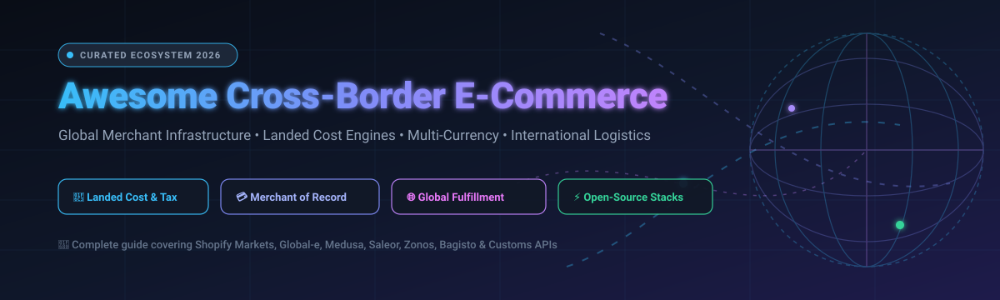
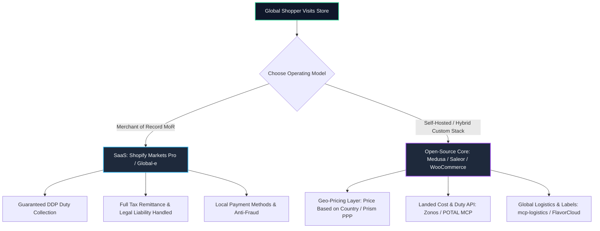

  

# 🌐 Awesome Cross-Border E-Commerce 

> 🛍️ **A curated directory of top SaaS platforms, open-source frameworks, landed cost calculation engines, customs compliance APIs, and global logistics infrastructure for cross-border e-commerce.**

---

## 📑 Table of Contents
- [📊 Sector Overview & Market Dynamics](#-sector-overview--market-dynamics)
- [☁️ Top SaaS & Hosted Cross-Border Platforms](#️-top-saas--hosted-cross-border-platforms)
- [🔓 Open-Source E-Commerce & Customs Frameworks](#-open-source-e-commerce--customs-frameworks)
  - [⭐ Featured Open-Source Projects (Ranked by GitHub Stars)](#-featured-open-source-projects-ranked-by-github-stars)
  - [🧩 Specialized Cross-Border Plugins & Tooling](#-specialized-cross-border-plugins--tooling)
- [🛠️ Architectural Guidance & Stack Recipes](#️-architectural-guidance--stack-recipes)
- [🤝 How to Contribute](#-how-to-contribute)
- [💖 Support & Sponsorship](#-support--sponsorship)
- [📈 Star History](#-star-history)
- [⚖️ Disclaimer & Compliance Notice](#️-disclaimer--compliance-notice)

---

## 📊 Sector Overview & Market Dynamics

The global cross-border e-commerce market is projected to surpass **$1.2 trillion in core B2C volume by 2026** (with broad cross-border digital trade TAM estimates ranging between **$1.7 trillion and $5 trillion**), expanding at an annualized compound rate of **15% to 18%**. 

The sector is **moderately fragmented**: mega-ecosystems and public category leaders dominate Merchant of Record (MoR) and core platform layers (e.g., Shopify + Global-e), whereas regional carriers, customs brokerages, HS code classification engines, and localized payment gateways remain deeply fragmented across sovereign borders and local regulatory regimes.

---

## ☁️ Top SaaS & Hosted Cross-Border Platforms

These hosted platforms manage international store localization, automated customs clearance, DDP (Delivered Duty Paid) landed cost calculation, and Merchant of Record (MoR) legal liability.

| Platform | Market Size / Valuation / Revenue | Starting Tier Pricing | Free Tier / Trial Limit | Key Capabilities & MoR Support |
| :--- | :--- | :--- | :--- | :--- |
| **[Shopify Markets](https://www.shopify.com/markets)** | **~$220B Valuation** *(~$9B+ Annual TTM Rev)* | **$39/mo** *(Included in Shopify Basic; 1.5%–2% currency conversion fee)* | **3-day free trial** *(followed by $1/mo for initial 3 months, full admin access)* | Multi-currency, domain subfolders (`/fr`, `/de`), and localized price adjustments directly within standard Shopify admin. |
| **[Shopify Markets Pro](https://help.shopify.com/en/manual/markets/markets-pro/overview)** | **~$220B Ecosystem** *(Engine by Global-e)* | **6.5% transaction fee + 2.5% FX fee** *(No monthly base fee; cancel anytime)* | **None (Pay-as-you-transact)** *(Available to eligible US/Shopify merchants with $0 upfront commitment)* | Full Merchant of Record (MoR) powered by Global-e: guaranteed duty/tax at checkout, fraud protection, and remittance. |
| **[Global-e](https://www.global-e.com/)** | **~$6.5B Valuation** *(NASDAQ: GLBE, ~$1.2B+ ARR)* | **Custom enterprise rate** *(Typically 4%–7% fee per cross-border GMV + FX margin)* | **Custom live sandbox/demo** *(No self-serve free tier; enterprise contract scoping)* | The global leader in MoR infrastructure: 200+ markets, 100+ local currencies, 150+ payment methods, and guaranteed landed cost. |
| **[Reach](https://www.reach.com/)** | **~$100M–$250M Est. Valuation** *($10M–$30M ARR, VC-backed)* | **2.9% + $0.30 per international transaction** *(Varies based on volume and corridor)* | **Free sandbox account** *(Unlimited test API transactions in test environment)* | Merchant of Record (MoR) platform specializing in local payment acquiring, reducing cross-border FX fees, and chargeback coverage. |
| **[Zonos](https://zonos.com/)** | **~$100M–$200M Est. Valuation** *(Moffat, $10M–$25M ARR)* | **$0/mo base** *(Pay-as-you-ship: $2/order + 10% duty guarantee fee, or ~$2,000 setup)* | **Dashboard Lite: Free forever** *(Free HS lookup & duty estimator via partner postal links)* | AI-powered HS code classification, landed cost calculation engine, and DDP guarantees across 200+ destination jurisdictions. |
| **[Passport Global](https://passportglobal.com/)** | **~$100M–$150M Est. Valuation** *(Series B, $15M–$30M ARR)* | **Volume-based carrier rates** *(Custom rate card based on package weight/corridor)* | **Free logistics consultation** *(Demo test environment provided upon sales onboarding)* | End-to-end DTC cross-border shipping, automated DDP checkout landed cost calculation, and customs clearance handling. |
| **[FlavorCloud](https://www.flavorcloud.com/)** | **~$60M–$100M Est. Valuation** *(Series A, $8M–$20M ARR)* | **Pay-per-shipment transaction fee** *(Embedded into discounted international carrier rates)* | **Free onboarding consultation** *(Standard demo sandbox access upon scheduled setup)* | Automated DDP logistics, algorithmic routing across 300+ global carriers, and customs classification engine. |
| **[Glopal](https://www.glopal.com/)** | **~$30M–$60M Est. Valuation** *(European VC, $5M–$15M ARR)* | **$99/month + % of international GMV** *(Professional multi-store tier)* | **Free / Starter plan ($0/mo)** *(Basic localized international checkout & currency switch)* | International search marketing, localized Google Shopping ads, translation, and localized multi-currency checkout. |
| **[Flow Commerce](https://www.flow.io/)** | **Subsidiary of Global-e** *(Acquired for ~$500M in 2022)* | **Custom enterprise volume pricing** *(Modular API integration tier)* | **Sandbox test access** *(Provided during enterprise integration onboarding)* | API-first international localization engine for enterprise merchants, managing localized catalog pricing, tax, and duty. |
| **[Borderfree](https://www.borderfree.com/)** | **Subsidiary of Global-e** *(Acquired from Pitney Bowes)* | **Enterprise commission per order** *(Tiered by GMV & logistics routing)* | **Contracted pilot phase** *(Enterprise pilot program negotiated per brand)* | Heritage enterprise cross-border solution providing localized shopping, global logistics, and customs clearance. |

---

## 🔓 Open-Source E-Commerce & Customs Frameworks

Unlike hosted SaaS platforms that act as legal Merchants of Record, open-source solutions empower engineering teams to build and host multi-currency, multi-region stores while integrating sovereign duty APIs.

### ⭐ Featured Open-Source Projects (Ranked by GitHub Stars)

| Repository & Stars Badge | License | Stack | Cross-Border & Internationalization Capabilities |
| :--- | :---: | :---: | :--- |
| **[medusajs/medusa](https://github.com/medusajs/medusa)**  | `MIT` | Node.js / TypeScript | Headless e-commerce platform with native multi-region architecture: granular currency controls, region-based tax rates, multiple fulfillment providers, and localized pricing tiers per market. |
| **[bagisto/bagisto](https://github.com/bagisto/bagisto)**  | `MIT` | PHP / Laravel | Enterprise modular e-commerce system featuring multi-currency, multi-channel inventory, multilingual storefronts, and customizable localized tax calculation schemes out-of-the-box. |
| **[saleor/saleor](https://github.com/saleor/saleor)**  | `BSD-3-Clause` | Python / GraphQL / React | High-performance composable commerce engine with native multi-channel and multi-currency capabilities, allowing merchants to customize price books, shipping zones, and regional tax plugins per country. |
| **[spree/spree](https://github.com/spree/spree)**  | `BSD-3-Clause` | Ruby on Rails | Proven headless commerce platform with multi-store, multi-currency, and internationalized shipping calculation architecture suitable for global enterprise deployments. |
| **[woocommerce/woocommerce](https://github.com/woocommerce/woocommerce)**  | `GPL-3.0` | PHP / WordPress | The world's most widely adopted open-source commerce platform. Backs hundreds of international cross-border extensions for geo-pricing, tax zones, and global carrier integrations. |
| **[Sylius/Sylius](https://github.com/Sylius/Sylius)**  | `MIT` | PHP / Symfony | Modern modular commerce framework built on Symfony components; supports custom exchange rates, zone-specific taxes, multi-locale translations, and tailored shipping calculations per destination country. |
| **[solidusio/solidus](https://github.com/solidusio/solidus)**  | `BSD-3-Clause` | Ruby on Rails | Battle-tested, fork-friendly commerce framework emphasizing complex international logistics, multiple payment gateways, and customizable regional tax rules. |
| **[marian-kadanka/woocommerce-product-price-based-on-countries](https://github.com/marian-kadanka/woocommerce-product-price-based-on-countries)**  | `GPL-2.0` | PHP / WordPress | Community-maintained implementation of Price Based on Country for WooCommerce, adding geolocation-based price switches, manual country price overrides, and multi-currency rendering. |
| **[woocommerce/customs-fees-for-woocommerce](https://github.com/woocommerce/customs-fees-for-woocommerce)**  | `GPL-3.0` | PHP / WordPress | Official WooCommerce extension displaying estimated customs, tariffs, and import charges at checkout based on CIF (Cost, Insurance, Freight) calculations per target destination. |
| **[zavora-ai/mcp-logistics](https://github.com/zavora-ai/mcp-logistics)**  | `Apache-2.0` | TypeScript / MCP | Model Context Protocol server exposing 16 logistics tools across ShipEngine and Shippo for multi-carrier cross-border shipping comparison, tracking, and label generation. |
| **[CoderOtakuX/Prism](https://github.com/CoderOtakuX/Prism)**  | `MIT` | Next.js / TypeScript | Open-source global link-in-bio storefront demonstrating automated location detection, Purchasing Power Parity (PPP) localized pricing adjustments, and dynamic AI localization. |

---

### 🧩 Specialized Cross-Border Plugins & Tooling

- **[POTAL MCP Server](https://socket.dev/npm/package/potal-mcp-server)** 📦 — Model Context Protocol wrapper for global landed cost estimation across 240+ countries. Codifies 257M+ tariff schedules, 592 General Rules of Interpretation (GRI), and provides denied-party screening tools (requires POTAL API key).
- **[Openfront](https://openfront.io/)** 🛒 — Open-source headless storefront built with Next.js and KeystoneJS, engineered specifically for multi-region catalog deployment, localized currencies, and Stripe multi-region payment flows.

---

## 🛠️ Architectural Guidance & Stack Recipes

When designing a production cross-border e-commerce tech stack, choose the architecture suited to your operational scale and tax nexus:

### 💡 Suggested Composable Configurations

1. **Self-Hosted Headless Stack (Modern)**: 
   - Core: [Medusa](https://github.com/medusajs/medusa) or [Saleor](https://github.com/saleor/saleor)
   - Landed Cost Engine: [Zonos API](https://zonos.com/) or [POTAL MCP](https://socket.dev/npm/package/potal-mcp-server)
   - Fulfillment: [mcp-logistics](https://github.com/zavora-ai/mcp-logistics) connected to ShipEngine
2. **WordPress / WooCommerce Native Stack (Cost-Effective)**:
   - Currency & Pricing: [Price Based on Country](https://github.com/marian-kadanka/woocommerce-product-price-based-on-countries)
   - Transparent Import Fees: [WooCommerce Customs Fees](https://github.com/woocommerce/customs-fees-for-woocommerce)
3. **Turnkey Enterprise (Zero Tax Nexus Liability)**:
   - Platform: [Shopify Markets Pro](https://help.shopify.com/en/manual/markets/markets-pro/overview) or [Global-e](https://www.global-e.com/)

---

## 🤝 How to Contribute

Contributions are warmly welcomed! Help expand this ecosystem map by adding verified platforms, open-source libraries, or developer tools:

1. 🍴 Fork the repository.
2. 🌿 Create a descriptive branch (`git checkout -b add-cross-border-tool`).
3. ✍️ Add the product or repository to `README.md` following the tabular formatting with verifiable pricing, company valuation, and star metrics.
4. 🚀 Open a Pull Request with a short summary of the addition.

---

## 💖 Support & Sponsorship

Thank you so much for exploring and using **Awesome Cross-Border E-Commerce**! 🌟

If you found this curated ecosystem, landed cost breakdowns, or open-source stack recipes helpful:
- ⭐ **Star this repository** to help other developers and e-commerce founders discover it.
- 🍴 **Fork and contribute** tools, plugins, or updates to keep it accurate.
- 📢 **Share it** with international expansion teams, developers, and tech communities!

☕ **Buy a coffee & sponsor ongoing maintenance:**  
Support the project directly on GitHub Sponsors:  
👉 **[Sponsor Dashboard: github.com/sponsors/ishandutta2007](https://github.com/sponsors/ishandutta2007)**

---

## 📈 Star History

---

## ⚖️ Disclaimer & Compliance Notice

- *This repository is community-curated for informational and architectural purposes.*
- *Cross-border commerce entails rigorous tax laws (VAT, GST, IOSS, de minimis thresholds) and customs documentation requirements. Incorrect HS code classification or under-declaring import values can result in customs border penalties, delays, or shipment confiscation.*
- *Ensure you verify commercial licenses and developer terms before deploying open-source or proprietary APIs.*

---

  Maintained by <a href="https://github.com/ishandutta2007">ishandutta2007</a> and the global e-commerce open-source community.

